# The Dashboard

[The ledger in a browser](browser.md) opened one ledger's pages. The Dashboard is the page above them,
at `/dashboard`: a chart of every ledger you may read, a table of every agent working in them, and,
for an operator, what the server's cache and disks are doing. Use it to see what agents have been doing
across your ledgers.

An empty ledger makes a dull Dashboard, so this chapter fills a scratch gonk with eight weeks of fake
history first. Then it goes through the page one tab at a time. The pictures are screenshots of a real
browser on that same seed, and the numbers in the commands below are checked against gonk every time
this book is built. Your dates will differ from the pictures' dates, because the seed counts back from
today. The numbers will not.

## An invented project

[`seed.py`](dashboard/seed.py) writes the history of *Pinwheel*, a project nobody has built, with no
real names in it. It has three ledgers, `app`, `docs` and `infra`. Two machines, `alpha` and `beta`, each
run a Claude loop and a Codex loop, as [Routing work to agents](../ways/routing.md) shows later in the
book. That makes four holders: `alpha-claude`, `alpha-codex`, `beta-claude` and `beta-codex`. Every third
item carries the shared `worker:pool` label, so either machine takes it.

Over those weeks the loops do what loops do: items are filed, claimed and handed back; a dispatcher
closes them; some are sent back with a reason and handed back again; some are claimed and plainly
released, or a run stops, and another holder picks them up; a few are closed as not worth doing, or
reopened. For nine days the dispatcher is away, so finished work waits and is closed in a batch.

Nothing in it is random. In a new empty directory, save the linked file as `seed.py`. Run the commands
in this chapter from that directory. Look through the file first: the story is a short table.

<!-- transcripts: workspace books/gonk/src/ledger/dashboard/seed.py -->
<!-- transcript: run -->
```console
$ python3 seed.py | wc -l
637
$ python3 seed.py | sed -n 1p
sink urn:iki:ledger:app:append labels=worker:alpha,agent:claude created=… Fix the spinner
```

Each line is one `ikigai` command. They name past dates, which a ledger does not normally allow.

### Who may name a past date

A ledger stamps its own clock on every write, so a caller cannot rewrite when something happened. Ask
it over the owner's socket, and even the owner is refused. That comes in a moment, once there is a gonk
to ask.

The exception is an *import principal*: an identity the owner enrolled to carry another system's history
across, which is the one caller that may claim a date. That is what this seed is, a very small importer.
So it gets a client certificate, with a grant that writes all three ledgers:

<!-- transcript: run -->
```console
$ mkdir -p .config/ikigai
$ ikigai-gonk client add pinwheel --ledger app=write --ledger docs=write --ledger infra=write --port 1070 --config-home "$PWD/.config/ikigai"
client `pinwheel`  …/.config/ikigai/gonk/quic/clients/pinwheel
  fingerprint  …
  principal    urn:iki:host:gonk:client:…
  enrolled     grant `pinwheel` (13 scopes) in …/.config/ikigai/gonk/grants.json
…
```

The last two tabs are for an operator, so make one now, before gonk starts: a passkey invite, plus the
two tokens those tabs ask for, added to its grant in `grants.json`. Edit the file by hand if you prefer;
this line does the same:

<!-- transcript: run -->
```console
$ ikigai-gonk passkey invite operator --ledger app=write --ledger docs=write --ledger infra=write --port 1070 --config-home "$PWD/.config/ikigai" --data-home "$PWD/.ikigai"
passkey invite for `operator` — grant `operator` (13 scopes) in …/.config/ikigai/gonk/grants.json
  valid for 30 minutes, once
  open  http://localhost:1070/#invite=…
  in a browser on this machine (localhost, not 127.0.0.1); the passkey is enrolled in …/.config/ikigai/gonk/clients.json
$ python3 -c "import json; p='.config/ikigai/gonk/grants.json'; g=json.load(open(p)); g['operator'] += ['urn:cap:kernel:inspect', 'urn:cap:gonk:system:read']; json.dump(g, open(p, 'w'), indent=2)"
$ grep -c 'urn:cap:gonk:system:read' .config/ikigai/gonk/grants.json
1
```

Start gonk with both its homes here, as [A ledger of your own](your-own.md) does, and name the three
ledgers for the HTTP door's anonymous reader. If the gonk from [Checking what you have](checking.md) is
still running, stop it first, since this one takes the same port. There is no `--no-backup` this time, because the System tab has a backup schedule to report:

<!-- transcript: serve -->
```console
$ ikigai-gonk --config-home "$PWD/.config/ikigai" --data-home "$PWD/.ikigai" --port 1070 --http-ledger app --http-ledger docs --http-ledger infra
ikigai-gonk 0.1.1 — holding the store at …/.ikigai/store
  instance … — new at every start; open pages compare it
  http    http://localhost:1070/ — loopback (127.0.0.1:1070); anonymous read: app, docs, infra; …
…
  quic    udp 0.0.0.0:1070 — 1 trusted certificate(s), 1 enrolled
…
```

Here is the refusal. The owner's socket has every authority over this server, and it still may not say
when something happened:

<!-- transcript: run -->
```console
$ ikigai --mount "urn:gk:=$PWD/.ikigai/gonk.sock" -c 'sink urn:gk:iki:ledger:app:append created=2020-01-01T00:00:00Z Backdated'
error: denied: `created=2020-01-01T00:00:00Z` refused: only an import or sync principal may claim an authored date, and this capability carries no principal, so nothing says it is an import principal. Send it without `created`, and the ledger stamps the time itself
…
```

Enrolling the client is the owner's word that this one identity may do it. Then run the seed through it:

<!-- transcript: run -->
```console
$ ikigai-gonk ledger enroll pinwheel --importer --config-home "$PWD/.config/ikigai" --data-home "$PWD/.ikigai"
enrolled in <urn:collab:participants>: <urn:iki:host:gonk:client:…> <http://www.w3.org/1999/02/22-rdf-syntax-ns#type> <https://ikigai-rs.dev/ns/ledger#Importer> .
$ python3 seed.py | ikigai --connect quic://127.0.0.1:1070 --cert-dir .config/ikigai/gonk/quic/clients/pinwheel --quiet > seed.log 2>&1
$ grep -c '^error' seed.log || true
0
$ grep -c '^closed' seed.log
116
```

So the dates are in the graph, not faked in a page. Read one item's history back, and the ledger says
which dates it was told:

<!-- transcript: run -->
```console
$ ikigai --mount "urn:gk:=$PWD/.ikigai/gonk.sock" -c 'source urn:gk:iki:ledger:app:item:1:history' 2>/dev/null
app#1: 4 event(s)
… (claimed)  imported claim alpha-claude  by urn:iki:host:gonk:client:…
…  closed done  by urn:iki:host:gonk:client:…
…  claim alpha-claude  by urn:iki:host:gonk:client:…
…  release alpha-claude (closed)  by urn:iki:host:gonk:client:…
```

`(claimed)` marks a date an importer named. Each write the seed makes takes its date in its own way:
`append` takes `created=`, `comment` takes `created=`, `close` takes `closed-at=`, and past claims and
releases go in as a batch of Turtle to `urn:iki:ledger:{name}:history`, which records them and changes
nothing about the item. ⚠ One step has no date to claim. A hand-back names whoever holds the item at
that moment, so the seed takes a live claim first, and that claim and its release say today, as the last
two lines do. The Agents questions below are not moved by them: a release because of a close is not
letting go, and a hand-back is measured from the latest claim before it.

## Ledgers

Open <http://localhost:1070/dashboard>. Use `localhost`, for the reason [The ledger in a
browser](browser.md#the-pages) gives.

<!-- transcript: manual — it opens a browser, which a check cannot look at -->
```console
$ open http://localhost:1070/dashboard
```

<figure class="gonk-shot">
<a class="gonk-scheme-light" href="dashboard/img/ledgers-light.webp"></a><a class="gonk-scheme-dark" href="dashboard/img/ledgers-dark.webp"></a>
<figcaption>The Ledgers tab, one chart for each of the three ledgers.</figcaption>
</figure>

Each chart reads one ledger's `urn:iki:ledger:{name}:counts`, as you can:

<!-- transcript: run -->
```console
$ ikigai --mount "urn:gk:=$PWD/.ikigai/gonk.sock" -c 'source urn:gk:iki:ledger:app:counts days=1'
date,open,closed
…,11,64
[uncacheable]
$ curl -s http://127.0.0.1:1070/dashboard/panel/ledgers | grep -o 'As of [^<]*'
As of …: 11 open, 64 closed. Daily counts from … to …, in UTC.
As of …: 4 open, 21 closed. Daily counts from … to …, in UTC.
As of …: 6 open, 21 closed. Daily counts from … to …, in UTC.
```

<figure class="gonk-shot">
<a href="dashboard/img/chart-light.webp">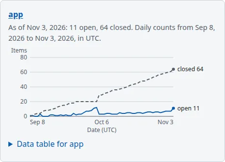</a>
<figcaption>One chart: the sentence, the two lines, and the table's disclosure.</figcaption>
</figure>

**What the lines mean.** The solid line is how many items were open at the end of each day; the dashed
line is how many were closed. Both count items, not events, so closing an item moves one count down and
one up, and a reopen moves them back. The two lines' sum grows by what was filed. In `app` you can read
the nine days the dispatcher was away: the closed line goes flat while the open line climbs, and a
single day repays it all.

**The as-of rule.** A chart's sentence starts `As of` a date, and that date is its last row. Each row is
that UTC date's *end of day*: an item closed that day counts as closed that day, and only items filed by
then count at all. So today's row is provisional, since today has not ended; the chart's last point can
still move, while earlier ones only move if history itself is changed. The day boundary is UTC whatever
your clock says, which is why the axis says so. And a chart reaches back 365 days, whatever a ledger's
age. A deleted item leaves the series, as it leaves the listing.

**Hovering.** At this gonk, a chart has no tooltip and hovering a line does nothing. The numbers are in
the table under the disclosure, which works from a keyboard and a screen reader alike:

<figure class="gonk-shot">
<a href="dashboard/img/chart-table-light.webp">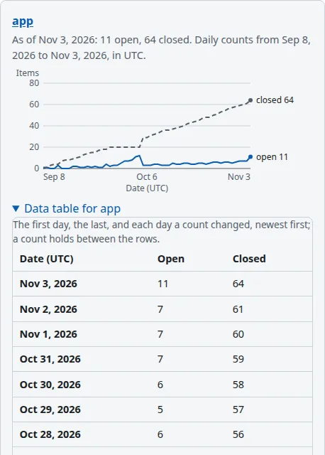</a>
<figcaption>The same chart with its data table open. Every number the lines draw is here as text.</figcaption>
</figure>

The table lists the first day, the last, and each day a count changed, so a quiet year is not 365 rows.

### When a chart cannot be drawn

A chart is a view of its counts, so when the counts refuse, the chart says why and the rest of the page
is untouched. The one refusal a ledger can cause by itself comes from an old close. Before `ikigai-ledger`
began recording `closedAt`, a close had no date, and `counts` refuses to guess: it would rather say
nothing than quietly count an undated close as open forever. So make one, by removing `infra`'s first
item's close date with a raw update. The owner's socket allows that, and nothing else here does:

<!-- transcript: run -->
```console
$ ikigai --mount "urn:gk:=$PWD/.ikigai/gonk.sock" -c 'sink urn:gk:iki:store:graph-update graph=urn:iki:ledger:graph:infra PREFIX ledger: <https://ikigai-rs.dev/ns/ledger#> WITH <urn:iki:ledger:graph:infra> DELETE { ?item ledger:closedAt ?at } WHERE { ?item ledger:number 1 ; ledger:closedAt ?at }'
updated <urn:iki:ledger:graph:infra>: +0 -1 quads
[uncacheable]
$ curl -s http://127.0.0.1:1070/dashboard/panel/ledgers | grep -o 'No chart: [^<]*'
No chart: the counts could not be read: a closed item has no readable closedAt; run backfill-closed-at explicitly before charting.
```

<figure class="gonk-shot">
<a class="gonk-scheme-light" href="dashboard/img/backfill-sentence-light.webp">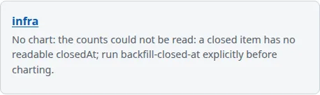</a><a class="gonk-scheme-dark" href="dashboard/img/backfill-sentence-dark.webp">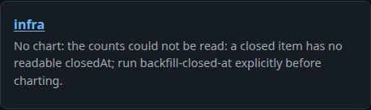</a>
<figcaption>Where <code>infra</code>'s chart was. The rest of the Dashboard still works.</figcaption>
</figure>

That sentence is the backfill sentence. It names the fix, which is one of the ledger's own actions, run
once by hand and never at startup. `all` dates every undated close from the item's last update (or name
one `item`, and its closing `comment=` if you know it):

<!-- transcript: run -->
```console
$ ikigai --mount "urn:gk:=$PWD/.ikigai/gonk.sock" -c 'sink urn:gk:iki:ledger:infra:backfill-closed-at all'
backfilled 1 items
[uncacheable]
$ curl -s http://127.0.0.1:1070/dashboard/panel/ledgers | grep -o 'As of [^<]*' | tail -n 1
As of …: 6 open, 21 closed. Daily counts from … to …, in UTC.
$ ikigai --mount "urn:gk:=$PWD/.ikigai/gonk.sock" -c 'source urn:gk:iki:ledger:infra:counts as=text/turtle days=1' 2>/dev/null | grep -c closedAtSource
1
```

<figure class="gonk-shot">
<a href="dashboard/img/backfill-repaired-light.webp">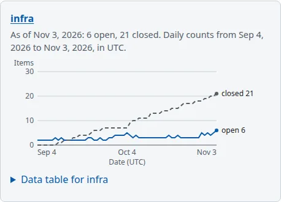</a>
<figcaption><code>infra</code> after <code>backfill-closed-at</code>: the chart is back.</figcaption>
</figure>

⚠ A backfilled date is an estimate. The ledger marks it: `ledger:closedAtSource "backfill"` on the item
and its close event, and on each Turtle observation up to the latest estimated day, so a chart of your
own can label that stretch approximate. CSV keeps its three columns and does not say. Here the estimate is
a poor one, as the last command shows: this item's last update was the seed's run, today, so even today's
observation carries the mark, and the chart now holds it open for eight weeks it was really closed. The
totals agree and the past does not. If you know which comment closed an item, name it.

## Agents

The second tab is a table per ledger, with a row per holder who ever took a claim there:

<figure class="gonk-shot">
<a class="gonk-scheme-light" href="dashboard/img/agents-light.webp"></a><a class="gonk-scheme-dark" href="dashboard/img/agents-dark.webp"></a>
<figcaption>The Agents tab: one table per ledger, one row per holder, every number a link.</figcaption>
</figure>

Anyone who may read a ledger can read its Agents table, with `curl` or a browser. The words each link
carries are written for a screen reader, and they are the plainest way to read the row:

<!-- transcript: run -->
```console
$ curl -s http://127.0.0.1:1070/dashboard/panel/agents | grep -o 'alpha-claude: </span>[^/]*</span>' | sed -n 1,7p | sed 's/<[^>]*>//g'
alpha-claude: 1 in flight, opens in a new tab
alpha-claude: 26 worked on, opens in a new tab
alpha-claude: 1 completed in the last 24 hours, opens in a new tab
alpha-claude: 3 completed in the last 7 days, opens in a new tab
alpha-claude: 1 handed back in the last 24 hours, opens in a new tab
alpha-claude: 3 released without a hand-back, opens in a new tab
alpha-claude: 2 h from claim to hand-back, the median, opens in a new tab
```

What each one counts:

| Column | The question |
|---|---|
| In flight | the items this holder holds right now |
| Worked on | the items this holder ever claimed |
| Completed, 24 hours and 7 days | items closed `done` in the window, whose *last* hand-back was this holder's |
| Handed back, 24 hours | this holder's hand-backs in the window |
| Released | items this holder let go with no hand-back since its latest claim: released, stopped or taken over |
| Median, claim to hand-back | the middle of this holder's times from claim to hand-back, the lower of two |

So a close that was not `done` completes nothing, and when a rejected item is handed back again, only the
final hand-back gets the credit. `alpha-codex` works in `app`, `docs` and `infra`, and has a row in each
with different numbers, because a question reads one ledger's graph. Windows end on the minute, and the
tab's opening sentence names which minute.

**Each number is a question you can click.** Here is `alpha-claude`'s Worked on in `app`, focused:

<figure class="gonk-shot">
<a href="dashboard/img/agents-number-focused.webp">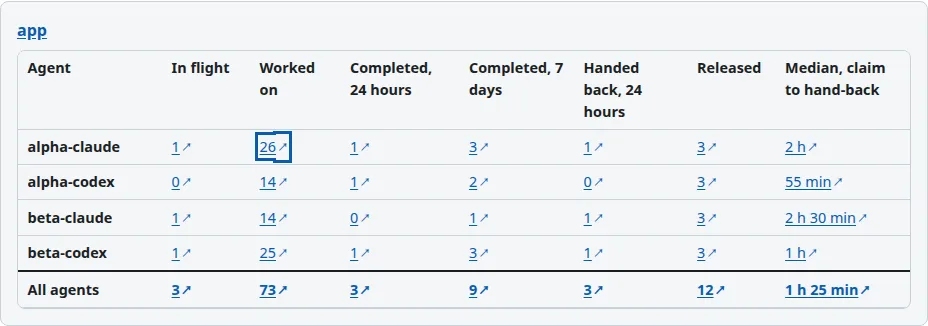</a>
<figcaption>alpha-claude's Worked on number in app, focused, with the mark that says its link opens a new tab.</figcaption>
</figure>

The link opens the SPARQL page, in a new tab, already running the question with the holder written in:

<figure class="gonk-shot">
<a href="dashboard/img/agents-sparql-query.webp">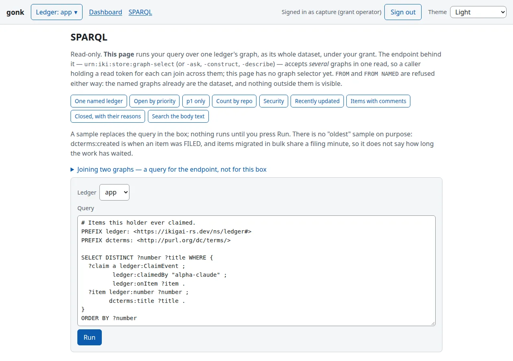</a>
<figcaption>The tab that number opens, at its top: the question, with the holder's name written in.</figcaption>
</figure>

<figure class="gonk-shot">
<a href="dashboard/img/agents-sparql-results.webp">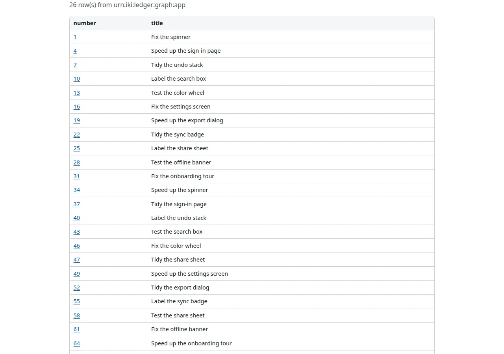</a>
<figcaption>The same tab as it opens, at its results. The row count is the number that was clicked.</figcaption>
</figure>

The number is the row count of that query, so the page never summarizes something it will not show you.
The link is plain text, and you can read it from a shell. This is its query, percent-decoded:

<!-- transcript: run -->
```console
$ curl -s http://127.0.0.1:1070/dashboard/panel/agents | grep -o 'href="/sparql[^"]*' | sed -n 2p | python3 -c "import sys, html, urllib.parse as u; print(u.unquote(html.unescape(sys.stdin.read())))"
href="/sparql?ledger=app&query=# Items this holder ever claimed.
PREFIX ledger: <https://ikigai-rs.dev/ns/ledger#>
PREFIX dcterms: <http://purl.org/dc/terms/>
…
SELECT DISTINCT ?number ?title WHERE {
  ?claim a ledger:ClaimEvent ;
         ledger:claimedBy "alpha-claude" ;
         ledger:onItem ?item ;
         dcterms:created ?at .
  ?item ledger:number ?number ;
        dcterms:title ?title .
}
ORDER BY ?number
#results
```

Run the same question through the SPARQL Protocol and count. The extra line is the CSV header:

<!-- transcript: run -->
```console
$ curl -s -G -H 'Accept: text/csv' --data-urlencode 'ledger=app' --data-urlencode 'query=PREFIX ledger: <https://ikigai-rs.dev/ns/ledger#> SELECT DISTINCT ?number WHERE { ?claim a ledger:ClaimEvent ; ledger:claimedBy "alpha-claude" ; ledger:onItem ?item . ?item ledger:number ?number }' http://127.0.0.1:1070/sparql | wc -l
27
```

⚠ A question reads events the ledger began writing in 0.15, so older claims are not counted, and the
tab's sentence says so. It is also why your first look at a long-lived ledger may show low numbers.

## Polling, and pausing it

While a tab is showing, each chart and table asks for itself every 30 seconds. Only the tab on screen
asks, so an unopened tab's questions cost nothing. Each response includes an `ETag`, a validator for
that content. The next request sends it back in `If-None-Match`; unchanged content gets HTTP `304`
with no response body. Here is that exchange by hand:

<!-- transcript: run -->
```console
$ curl -s -D - -o /dev/null http://127.0.0.1:1070/dashboard/chart/app | grep -i '^etag' | cut -d' ' -f2 | tr -d '\r' > etag.txt
$ curl -s -o /dev/null -w '%{http_code}\n' -H "If-None-Match: $(cat etag.txt)" http://127.0.0.1:1070/dashboard/chart/app
304
```

The page reads differently once its script runs. As served, it says the numbers are as of its load, which
is true with no script, and the button is hidden, because with no script there is nothing to pause:

<!-- transcript: run -->
```console
$ curl -s http://127.0.0.1:1070/dashboard | grep -o "<button[^>]*dashboard-pause[^<]*</button>"
<button hidden='hidden' id='dashboard-pause' type='button'>Pause updates</button>
$ curl -s http://127.0.0.1:1070/dashboard | grep -o 'These numbers are[^<]*'
These numbers are as of when this page loaded.
```

With the script, the button appears and the sentence says the numbers update. Press it:

<figure class="gonk-shot">
<a href="dashboard/img/paused.webp"></a>
<figcaption>The control after a press: Resume updates, and a sentence that says the numbers will stay as they are.</figcaption>
</figure>

Your choice is remembered in this browser. A panel also holds still while your focus is inside it or the
browser tab is hidden, and a real change is announced once, politely. There is no push: gonk's door has no
stream to push on, which is why this is polling.

## Sign in, for the last two tabs

The anonymous reader has been offered two tabs, and asking for the others is refused:

<!-- transcript: run -->
```console
$ curl -s http://127.0.0.1:1070/dashboard | grep -o "id='dashboard-tab-[a-z]*'"
id='dashboard-tab-ledgers'
id='dashboard-tab-agents'
$ curl -s -o /dev/null -w '%{http_code}\n' http://127.0.0.1:1070/dashboard/cache
403
$ curl -s -o /dev/null -w '%{http_code}\n' http://127.0.0.1:1070/dashboard/system
403
```

A viewer whose grant does not hold a tab's token never sees the tab. Open the invite the `passkey invite`
line printed, create the passkey, and sign in, as [The ledger in a browser](browser.md) walks through.

<!-- transcript: manual — a passkey is created by a browser and an authenticator, which a check cannot be -->
```console
$ open "http://localhost:1070/#invite=…"
```

## Cache

| Tab | Token |
|---|---|
| Cache | `urn:cap:kernel:inspect` |
| System | `urn:cap:gonk:system:read` |

<figure class="gonk-shot">
<a class="gonk-scheme-light" href="dashboard/img/cache-light.webp">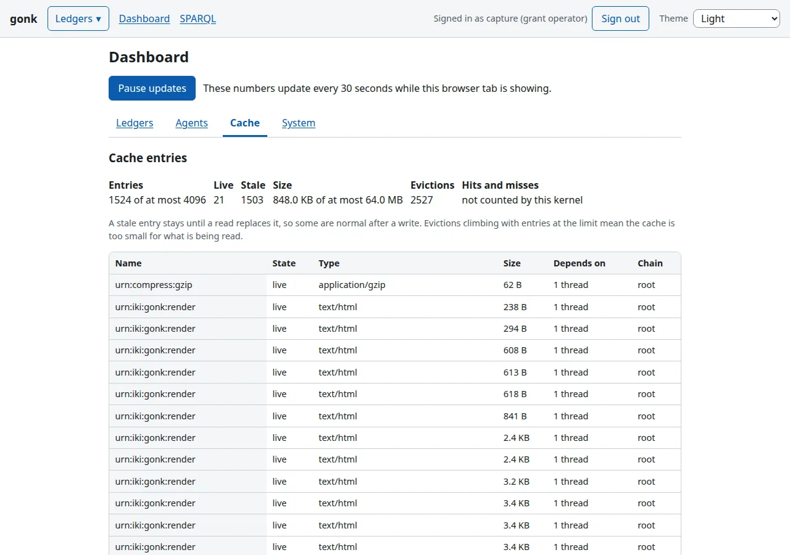</a><a class="gonk-scheme-dark" href="dashboard/img/cache-dark.webp">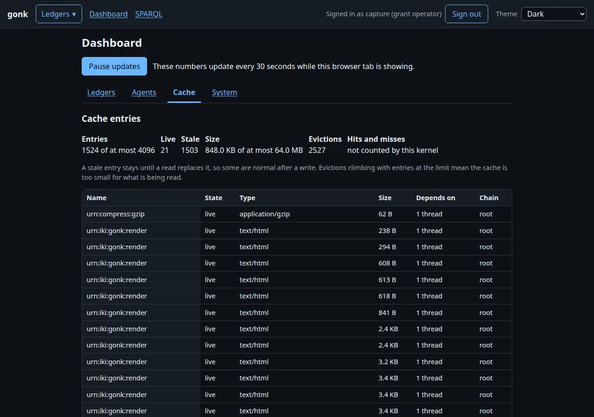</a>
<figcaption>The Cache tab's first screen: the totals, and the table of entries beginning.</figcaption>
</figure>

This tab reads the kernel's own readouts, `urn:kernel:cache`, `urn:kernel:threads` and
`urn:kernel:uncached`. Whose kernel matters. gonk has one hub, which holds the only cache in the process,
and a door kernel per door, which caches nothing and answers `urn:kernel:*` for itself. So ask over the
socket and you get a truthful, useless answer, about the socket's door:

<!-- transcript: run -->
```console
$ ikigai --mount "urn:gk:=$PWD/.ikigai/gonk.sock" -c 'source urn:gk:kernel:cache'
cache
  entries  0 / 4096 (0 stale)
  size     0 B / 64.0 MB
  policy   custom
  evictions  0
[uncacheable]
```

The tab reaches past its door to the hub, under your own capability, which is why it needs the token and
why it is the place to read this.

**Reading it.** The totals say how full the cache is. Here nearly everything is stale, because the seed
wrote hundreds of times just before this was read, which is about the least flattering moment to look. *Hits and misses* says `not counted by this kernel`
rather than showing a zero, because a zero would be a claim. Names are shown and arguments never are: a
SPARQL query's text is an argument, and it can say what someone else was reading.

**A stale entry.** An entry's state is `live`, `cut` or `expired`. Cached reads hang from golden threads,
and a write cuts the threads its reads hang from, so the entries go stale and the next read recomputes.
Stale is not a fault: a stale entry stays until a read replaces it. To see one, read a chart and then
write to its ledger:

<!-- transcript: run -->
```console
$ ikigai --mount "urn:gk:=$PWD/.ikigai/gonk.sock" -c 'sink urn:gk:iki:ledger:app:comment item=1 A note, so the cache has something stale.'
commented on app#1 (urn:iki:ledger:app:comment:…)
[uncacheable]
```

Reload the Ledgers tab and then the Cache tab, and scroll down:

<figure class="gonk-shot">
<a href="dashboard/img/cache-stale.webp">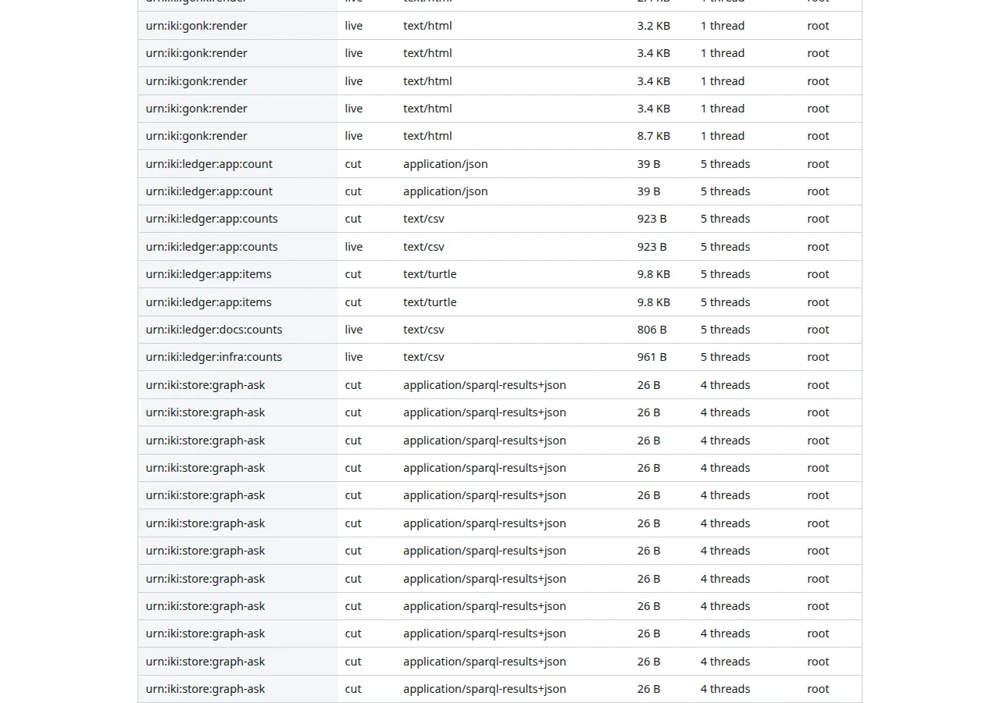</a>
<figcaption>Further down the same table, after one comment on <code>app</code>: <code>app</code>'s reads are <code>cut</code>, <code>docs</code> and <code>infra</code>'s counts are <code>live</code>.</figcaption>
</figure>

`app`'s old answers are `cut`, and `urn:iki:ledger:app:counts` is there twice, the old answer and the one
the reload just computed. The `urn:iki:store:graph-ask` rows below them are `cut` as well. The second table,
*Golden threads*, counts how often each thread was cut, and one that is cut often makes everything hanging
from it recompute as often. What to worry about is *Evictions* climbing with entries at the limit, which
says the cache is too small for what is being read.

**Why a read was not cached.** The third table lists what was computed and not kept, most recent first.
gonk's first scheduled backup is a minute after it starts; take one now rather than wait, so the table has
something in it:

<!-- transcript: run -->
```console
$ ikigai --mount "urn:gk:=$PWD/.ikigai/gonk.sock" -c 'source urn:gk:iki:gonk:backup' 2>/dev/null | grep -c '^backup'
1
```

<figure class="gonk-shot">
<a href="dashboard/img/cache-uncached.webp">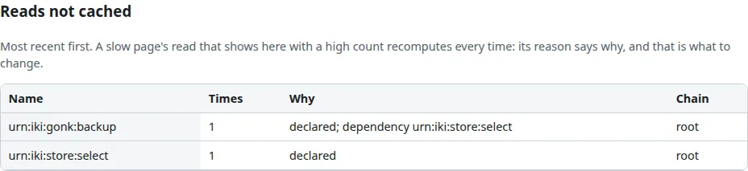</a>
<figcaption>Reads not cached: what this gonk computed and threw away, and why.</figcaption>
</figure>

The reason is the thing to read. `declared` means the read's own endpoint said not to keep its answer, and
`dependency` names a read beneath it that said so. Here that is the backup you just took and the store read
inside it. A backup ought never to be served from a cache. Look here when a page is slow: a read that shows up with a high count recomputes
every time, and its reason is what to change.

## System

<figure class="gonk-shot">
<a class="gonk-scheme-light" href="dashboard/img/system-light.webp"></a><a class="gonk-scheme-dark" href="dashboard/img/system-dark.webp"></a>
<figcaption>The System tab: disk, store and backups, gonk itself, workers, and what is claimed now.</figcaption>
</figure>

From the top:

- **Disk** has the free and total bytes of the store's volume and the backups' volume, and needs attention
  under 30 GiB, the workers' own default floor, so a worker holding back and this tab agree. Each worker's
  latest `Disk:` line follows, in its own words. A machine in the picture and a machine you run this on
  have different disks, so your numbers will differ.
- **Store** has the quads, size on disk, the last backup and how old it is. The per-graph counts are the
  ones that backup recorded, and they say so, because counting live would scan the store on every poll.
- **gonk** has the version, commit, build time, uptime, doors listening and linked crates. If the commit is
  not the one you deployed, the running process is older than its binary.
- **Workers** finds each open item labeled `worker-status:<name>` in a ledger you may read, and shows its
  latest `Worker:` and `Disk:` lines. A worker's words are its own, so they are shown as text and no link is
  made from them.
- **Items claimed now** is what its name says. An item held long past its lease is what to release.

Three of these are resources in their own right, in JSON, at every door, for a grant holding the token. The
owner's socket holds every token:

<!-- transcript: run -->
```console
$ ikigai --mount "urn:gk:=$PWD/.ikigai/gonk.sock" -c 'source urn:gk:iki:gonk:system:gonk' 2>/dev/null | grep -o '"commit":"[^"]*"'
"commit":"{{#include ../../gonk.rev}}"
$ ikigai --mount "urn:gk:=$PWD/.ikigai/gonk.sock" -c 'source urn:gk:iki:gonk:system:disk' 2>/dev/null | grep -o '"name":"[^"]*"'
"name":"Store"
"name":"Backups"
$ ikigai --mount "urn:gk:=$PWD/.ikigai/gonk.sock" -c 'source urn:gk:iki:gonk:system:store' 2>/dev/null | grep -o '"every_seconds":[0-9]*'
"every_seconds":86400
```

The fourth, `urn:iki:gonk:system:workers`, reads ledgers, so it is bound where ledger names are, on the HTTP
door, and the socket has no such endpoint. The items it reads are ordinary:

<!-- transcript: run -->
```console
$ curl -s -G -H 'Accept: text/csv' --data-urlencode 'ledger=infra' --data-urlencode 'query=PREFIX ledger: <https://ikigai-rs.dev/ns/ledger#> SELECT ?label WHERE { ?item ledger:status ledger:open ; ledger:label ?label . FILTER(STRSTARTS(STR(?label), "worker-status:")) } ORDER BY ?label' http://127.0.0.1:1070/sparql
label
worker-status:alpha
worker-status:beta
```

⚠ `urn:cap:gonk:system:read` is an operator's token and a real grant. It shows every graph's name and size,
whichever ledgers its holder may read, and where the store and the backups are on disk. Give it to the
person who runs the server. The workers' lines and claimed items are the exception, since they come only from
ledgers the viewer may read.

## What you have now

The Dashboard added no authority and no data of its own. Each tab is a view of a resource you could already
read, read under your own grant, and each number on it can be traced to the query or readout that produced
it. Stop the gonk with Ctrl-C when you are done. Its home directories are only this chapter's.

[The next chapter](lifecycle.md) gives a ledger states of its own.

(The pictures in this chapter are captures of a real browser, made by `scripts/capture-dashboard.sh` from
[the same seed](dashboard/seed.py). Regenerating them is that one command.)
