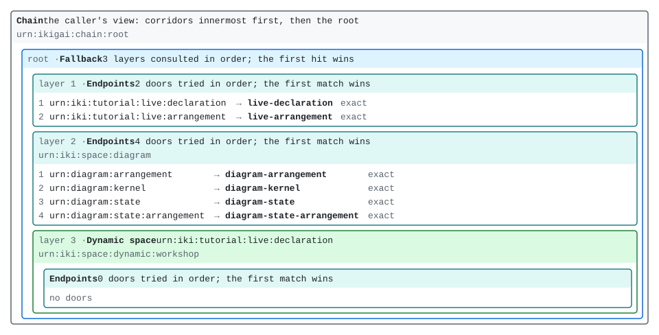
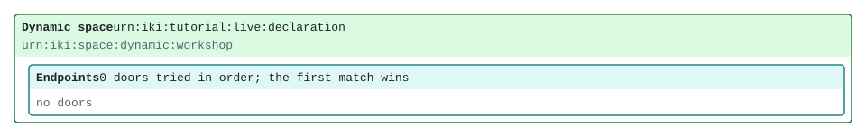
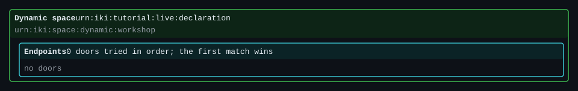
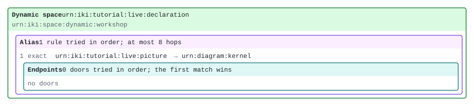
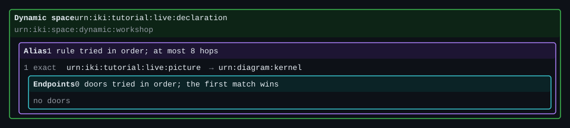

# A space that changes while it runs

[Tic-tac-toe, VII](tic-tac-toe-7.md) moved the game's arrangement into a file. The endpoints
stayed in Rust, in a `Registry`, and core's `build` read the file once, when the kernel was
made, and handed back a space. It also drew that space with `ikigai_diagram::render`. What it
could not do is change the space afterwards: to give the game a door it did not have, you
edited the file and built a new kernel.

This chapter keeps the same two halves, a registry of endpoints and a declaration that only
arranges them, and lets the declaration change while the kernel runs. The tool is
`ikigai-core`'s `DynamicSpace` (0.1.109, ledger #2006): a space inside the host's root that
rebuilds itself from a **declaration resource** whenever that resource is written. The root
never changes. Only the doors inside the dynamic space do.

It leans on one rule from [Golden threads in practice](../getting-started/golden-threads.md):
a cut takes what hung from it. Every answer a dynamic space serves hangs from one thread that
the space owns, and every change to the space cuts that thread. That is why a removed door
takes its cached answers with it.

Nothing here needs a server or a REPL. If a `ttt-host` or an `ikigai serve` from an earlier
chapter is still running, it can stay running: this chapter uses neither. Every listing below
runs on every build of the book, against the crate `crates/live-space`.

The same host also runs in this page. The cells below that say "in the live host" run their
lines in it: the root `crates/live-space` builds, with an empty dynamic space called
`workshop`, started the first time you press Run in one of them. It is a kernel of its own,
beside the one the book's other cells share, because that one already binds Part I's names,
and an empty space would not look empty in front of them. Its rebuild loop is the chapter's
`drive`, running on the page's own event loop. Run the cells in order: each one changes the
host the next one reads. The four parts of the chapter that change the space are numbered
**stages**, one tab each, with the space drawn as it was after each one ([below](#the-space-in-stages)).

## The host

<!-- urn-gate: illustration urn:iki:space:dynamic:workshop — the dynamic space's name, and its
     thread's. A space and a thread, not a resource: only its `:status` door answers. -->
<!-- urn-gate: illustration urn:iki:space:diagram — the name ikigai-diagram's space claims, as
     the picture prints it. Not a resource. -->

The registry holds four endpoints the book already wrote: Part I's `camel-case`, `title` and
`camel-title` (from [Hello, resource](../getting-started/hello-resource.md)), and ikigai-fn's
`toUpper`. Each is registered under the name it gives itself, and none of them is bound to
any name yet:

```rust,ignore
{{#include ../../../../crates/live-space/src/lib.rs:registry}}
```

They are three kinds of endpoint: a pure function of its argument (`camel-case`, `toUpper`),
an endpoint over state the host holds (`title`), and a composite that reads another resource
through the kernel (`camel-title` reads `title`). The registry does not care which is which.
A declaration binds a door to an endpoint by its name, and never makes one.

The declaration lives at a name of its own:

```rust,ignore
{{#include ../../../../crates/live-space/src/lib.rs:names}}
```

`Sink` writes an arrangement there, in the s-expression form Tic-tac-toe VII's file is
written in; `Source` answers it as the `ik:` Turtle core builds from. Beside it is the dynamic
space in words, `urn:iki:tutorial:live:arrangement`: a line for the space, and one for each
space and door it holds, read from the kernel's topology, so it says what is in force rather
than what was last written. The host's root is three layers: those two, then `ikigai-diagram`'s
space (`urn:diagram:kernel`, the picture Tic-tac-toe VII drew from a file, here drawn from the
running kernel, beside the `urn:diagram:state` pair that draws governors' state over an
arrangement, which this chapter does not use), then the dynamic space:

```rust,ignore
{{#include ../../../../crates/live-space/src/lib.rs:kernel}}
```

The order matters: no door the declaration binds can shadow the declaration, or the picture.

Starting the host is three steps: make the space, put it in the kernel, and start the loop
that rebuilds it:

```rust,ignore
{{#include ../../../../crates/live-space/src/lib.rs:start}}
```

`DynamicSpace::new` is where the space gets its name. `"workshop"` becomes
`urn:iki:space:dynamic:workshop`, which is the space's name, the name of the thread every
answer it serves hangs from, and the prefix of its status door.

`drive` is the host's loop. It listens for cuts of the declaration's thread, reads the
declaration, binds it if it is good, and waits again. A space's `resolve` is synchronous and
cannot read a resource, so the rebuild happens here, outside resolution, when the
declaration changes. Core has no runtime, so the host runs the loop on one. Here that is a
`LocalPool`, and `Host::write` lets it catch up after each write, so each listing reads in
order:

```rust,ignore
{{#include ../../../../crates/live-space/src/lib.rs:write}}
```

The write is an ordinary `Sink`. The kernel cuts the declaration's thread after it, as it
does after every write, and the loop hears that cut. Nothing else tells the space to change.

## The space, in stages

The kernel's state first: the whole host, as `urn:diagram:kernel` draws it. Before anything
is declared it looks like this, and once the page's host is running, every step you take below
redraws it here, so this picture is always the kernel as it is now:

<figure id="live-host" class="ikigai-stages-overview" style="margin: 1em 0">
<a href="live-space-host.svg"></a>
<figcaption>The host before anything is declared: <code>urn:diagram:kernel</code>, as the
host in <code>crates/live-space</code> answers it, held to it byte for byte by a test. Select
the picture to open it at full size.</figcaption>
</figure>

The third layer is the dynamic space: its name, the declaration it is built from, and inside
it, before anything is declared, an endpoint space with no doors. The status door is not drawn. The space answers it
itself, ahead of anything a declaration binds, so no declaration can shadow it.

Only the third layer changes, so the stages below draw only it: `focus=` on `urn:diagram:kernel`
(ikigai-diagram 0.2.4) draws one space and what it encloses, which is also what keeps the picture
legible on a narrow screen.

**How to read the stages.** A stage is the space after a step that changed it, and each one is a
numbered tab. Below the tabs, two pictures sit side by side (stacked on a phone): **After** is the
open tab's stage, and **Before** is the stage you compare it with, the one just before unless you
pick another from the "Compare with" list above them. Under them is what changed from Before to After, in words (the
space's words, `urn:iki:tutorial:live:arrangement`, compared line by line: the words that differ
are marked, and what they replaced is said beside them). Below that is the tab's step: a sentence
or two and a cell, whose Run button runs the step in this page's host.

Each picture says whose it is. Until you run a tab's step, its picture is the chapter's own, in a
dashed frame; run it, and After becomes the picture your host drew, in a solid frame. Run the tabs
in order: each step starts where the one before left the space. A cell that changes
nothing the space holds makes no stage. The line above the tabs keeps two facts current, each read
from the space's status door after every cell: how many declarations have bound, and the last
refusal. How each step works, as a Rust listing that runs on every build of the book, is after the
stages.

**Every picture is drawn once.** Both pictures are resources like any other: `urn:diagram:kernel`
is a pure function of the kernel's topology, so the kernel caches it, and the cached picture
hangs from `urn:kernel:bindings`, the thread every successful bind cuts. After every cell you run,
the page asks for both, the whole host above and the space below, as your own lines would. A cell that bound a new declaration cut the
thread, so the picture is drawn again, once; a cell that cut nothing gets the cached picture, and
the page says so. Switching tabs, or what you compare with, asks for nothing at all: each tab keeps the picture
its step drew.
The chapter's own pictures are files the same host drew natively, held to it byte for byte by a
test, so they show before the page's kernel loads, without it, and in print.

<div class="ikigai-stages" data-chain='live:workshop'
     data-overview='source urn:diagram:kernel scheme={scheme}' data-overview-target='live-host'
     data-overview-alt="The host's arrangement as nested boxes, as your kernel holds it now: a chain holding the root, a fallback of three layers: the declaration and its words, the diagram's four doors, and the dynamic space urn:iki:space:dynamic:workshop with what its declaration binds now, which the picture below the tabs says in words."
     data-picture='source urn:diagram:kernel scheme={scheme} focus=urn:iki:space:dynamic:workshop'
     data-words='source urn:iki:tutorial:live:arrangement'
     data-tabs-label='Stages of the dynamic space'
     data-alt="The live host's dynamic space urn:iki:space:dynamic:workshop, drawn as nested boxes: the space and the declaration it is built from, and inside it what it holds now. The host's other two layers are not drawn.">
<ul class="ikigai-stages-facts">
<li data-cmd='source urn:iki:space:dynamic:workshop:status' data-line='4'>installs: 0</li>
<li data-cmd='source urn:iki:space:dynamic:workshop:status' data-line='5'>refused: the declaration could not be read: not found: urn:iki:tutorial:live:declaration</li>
</ul>
<section class="ikigai-stage" data-label="empty">

## An empty space, with a name

Start the host, and ask the space what it holds: its status door,
`urn:iki:space:dynamic:workshop:status`, and `camel-case`, a name the registry could serve. The
host starts the first time a cell in it runs:

<div class="ikigai-run" data-live='workshop' data-cmd='source urn:iki:space:dynamic:workshop:status
source urn:iki:tutorial:camel-case in="resource oriented computing"'>
<pre class="ikigai-run-expected">space: urn:iki:space:dynamic:workshop
declaration: urn:iki:tutorial:live:declaration
in force: nothing (the space is empty)
installs: 0
refused: the declaration could not be read: not found: urn:iki:tutorial:live:declaration
[uncacheable]
error: no endpoint resolved for urn:iki:tutorial:camel-case</pre>
</div>

The space as it starts, which is the first stage:

<div class="ikigai-stage-result">
<p class="ikigai-stage-facts">installs: 0 · refused: the declaration could not be read: not found: urn:iki:tutorial:live:declaration</p>
<p class="ikigai-stage-picture"><a class="ikigai-scheme-light" href="live-space-stage-1-light.svg"></a><a class="ikigai-scheme-dark" href="live-space-stage-1-dark.svg"></a></p>
<pre class="ikigai-stage-words">dynamic space urn:iki:space:dynamic:workshop, built from urn:iki:tutorial:live:declaration
  holding: an endpoint space with no doors</pre>
</div>

The status says what is in force (nothing), how many declarations have bound (none), and
why: the loop's first read found no declaration. A space that cannot read its declaration
binds nothing, rather than guessing. Until a declaration binds, every name in it answers
`Unresolved`.


</section>
<section class="ikigai-stage" data-label="four doors">

## Doors, added by a write

Now write a declaration that binds all four endpoints. Three doors use the names Part I
used. `toUpper` gets one in the tutorial's namespace, `urn:iki:tutorial:upper`, because the
declaration chooses the names and the endpoint does not. In the page, the write is a `sink` to
the declaration, on one line, and the reads after it ask each door and the status. Run it after
stage 1's cell:

<div class="ikigai-run" data-live='workshop' data-cmd='sink urn:iki:tutorial:live:declaration (endpoints (door "urn:iki:tutorial:camel-case" camel-case) (door "urn:iki:tutorial:title" title) (door "urn:iki:tutorial:camel-title" camel-title) (door "urn:iki:tutorial:upper" toUpper))
source urn:iki:tutorial:camel-case in="resource oriented computing"
source urn:iki:tutorial:upper in="resource oriented computing"
source urn:iki:tutorial:camel-title
source urn:iki:space:dynamic:workshop:status'>
<pre class="ikigai-run-expected">ok
[uncacheable]
resourceOrientedComputing
[computed]
RESOURCE ORIENTED COMPUTING
[computed]
resourceOrientedComputing
[computed]
space: urn:iki:space:dynamic:workshop
declaration: urn:iki:tutorial:live:declaration
in force: b3:1fb3e978a7d7700944d5cb5ece16d741453c3de61ad7547be867d4ff14f0bbef
installs: 1
refused: nothing since the last bind
[uncacheable]</pre>
</div>

The write bound, so the space changed, and this is the second stage:

<div class="ikigai-stage-result">
<p class="ikigai-stage-facts">installs: 1 · refused: nothing since the last bind</p>
<p class="ikigai-stage-picture"><a class="ikigai-scheme-light" href="live-space-stage-2-light.svg"></a><a class="ikigai-scheme-dark" href="live-space-stage-2-dark.svg"></a></p>
<pre class="ikigai-stage-words">dynamic space urn:iki:space:dynamic:workshop, built from urn:iki:tutorial:live:declaration
  holding: an endpoint space with 4 doors, tried in order
    door urn:iki:tutorial:camel-case, answered by camel-case
    door urn:iki:tutorial:title, answered by title
    door urn:iki:tutorial:camel-title, answered by camel-title
    door urn:iki:tutorial:upper, answered by toUpper</pre>
</div>

All four answer, and `camel-title` still reads `title` through the kernel, as it did in
Part I. Its sub-request resolves from the root, finds `title` in the dynamic space, and
composes as before. The status counts one install. Its `in force` line is now the digest of
the declaration that bound.

The picture changed without anyone asking for it to change. `urn:diagram:kernel` is a
pure function of `urn:kernel:topology`, so it is cached, and the topology hangs from the
kernel's bindings thread, `urn:kernel:bindings`. A successful bind cuts that thread. That cut
is the only thing that makes the picture stale: nothing polls, and nothing redraws a picture
nobody asks for. The words hang from the same thread, for the same reason, and the page's next
read of each draws the stage below the tabs.

A page that listens for that thread (see [A spreadsheet, VII](spreadsheet-7.md), later in the
book) would redraw the picture the moment a change binds, with nobody running anything. That is
push, and the bindings thread is what it would listen to.


</section>
<section class="ikigai-stage" data-label="three doors">

## A door removed, and what it served

Before you change a space, you can ask what the change will cost. Every answer the space has
served hangs from its thread, so `urn:kernel:dependents` lists them, as it did for `title`'s
thread in [Golden threads in practice](../getting-started/golden-threads.md). After stage 2's
cell: read `camel-title` (cached, since that cell read it), ask what hangs from the space's
thread, remove the door with a declaration without `camel-title`, and ask both again:

<div class="ikigai-run" data-live='workshop' data-cmd='source urn:iki:tutorial:camel-title
source urn:kernel:dependents thread=urn:iki:space:dynamic:workshop
sink urn:iki:tutorial:live:declaration (endpoints (door "urn:iki:tutorial:camel-case" camel-case) (door "urn:iki:tutorial:title" title) (door "urn:iki:tutorial:upper" toUpper))
source urn:iki:tutorial:camel-title
source urn:kernel:dependents thread=urn:iki:space:dynamic:workshop'>
<pre class="ikigai-run-expected">resourceOrientedComputing
[cached]
dependents of urn:iki:space:dynamic:workshop  (cut 1 time)
  4 live cached entries hang from it — a cut makes them stale, and the next read of each recomputes it
  urn:iki:tutorial:camel-case   text/plain                     25 B  2 threads   root
  urn:iki:tutorial:camel-title  text/plain                     25 B  3 threads   root
  urn:iki:tutorial:title        text/plain                     27 B  2 threads   root
  urn:iki:tutorial:upper        text/plain                     27 B  2 threads   root
[uncacheable]
ok
[uncacheable]
error: no endpoint resolved for urn:iki:tutorial:camel-title
dependents of urn:iki:space:dynamic:workshop  (cut 2 times)
  (no live cached entry hangs from it: a cut would recompute nothing)
[uncacheable]</pre>
</div>

The door is gone from the space, which makes the third stage:

<div class="ikigai-stage-result">
<p class="ikigai-stage-facts">installs: 2 · refused: nothing since the last bind</p>
<p class="ikigai-stage-picture"><a class="ikigai-scheme-light" href="live-space-stage-3-light.svg"></a><a class="ikigai-scheme-dark" href="live-space-stage-3-dark.svg"></a></p>
<pre class="ikigai-stage-words">dynamic space urn:iki:space:dynamic:workshop, built from urn:iki:tutorial:live:declaration
  holding: an endpoint space with 3 doors, tried in order
    door urn:iki:tutorial:camel-case, answered by camel-case
    door urn:iki:tutorial:title, answered by title
    door urn:iki:tutorial:upper, answered by toUpper</pre>
</div>

`camel-title` answers `Unresolved`, the same answer as a name that was never bound, and its
cached answer is gone. If the cache had kept it, a reader would be served an answer from a
door that no longer exists, and no read could tell them so.

The `(cut 1 time)` is the first bind. A space's thread is cut by every bind, including the
one that filled it.

## A change refused

<!-- urn-gate: illustration urn:iki:tutorial:reverse — the door of a declaration this
     chapter's host refuses; nothing is ever bound there. -->

A declaration may only arrange what the host registered. This cell writes one that keeps
`toUpper` and adds a Lisp function, `lisp-reverse`, which this host never registered. After the
cell above: read `camel-case` (computed again, because the last cell's write cut what the space
had served), write the refused declaration on one line, ask the status, read `camel-case` again,
ask whether the stage's picture is still cached (the light one, exactly as the stages viewer
asks for it), and try the door the refused declaration wanted:

<div class="ikigai-run" data-live='workshop' data-cmd='source urn:iki:tutorial:camel-case in="resource oriented computing"
sink urn:iki:tutorial:live:declaration (endpoints (door "urn:iki:tutorial:upper" toUpper) (door "urn:iki:tutorial:reverse" lisp-reverse))
source urn:iki:space:dynamic:workshop:status
source urn:iki:tutorial:camel-case in="resource oriented computing"
cache urn:diagram:kernel scheme=light focus=urn:iki:space:dynamic:workshop
source urn:iki:tutorial:reverse in="a b"'>
<pre class="ikigai-run-expected">resourceOrientedComputing
[computed]
ok
[uncacheable]
space: urn:iki:space:dynamic:workshop
declaration: urn:iki:tutorial:live:declaration
in force: b3:f7851677bf49b2836e3bde448d7426881777cf6b4ef1c84eb1ee6da1090b0993
installs: 2
refused: &lt;urn:ikigai:space:_:1:door:2&gt; binds `lisp-reverse`, which the host did not register: a declaration arranges registered endpoints and never mints one
refused at: urn:ikigai:space:_:1:door:2
refused digest: b3:ce2d0b4eba8293992408c920f12d708cb45646334556b046ad6fd1985cb66605
[uncacheable]
resourceOrientedComputing
[cached]
cached
error: no endpoint resolved for urn:iki:tutorial:reverse</pre>
</div>

`installs: 2` counts the two declarations the cells above bound; the refused one is not
among them. The `in force` digest is still the last good one's, and `camel-case`, read just
before the write, is served from the cache after it. So is the picture: the refusal cut
neither the space's thread nor the kernel's bindings, so the picture and the words are the
same three doors they were before it. **No change**, then: this cell makes no stage. The
line above the tabs moves, because the status says what was refused, but nothing the space
holds did.


</section>
<section class="ikigai-stage" data-label="a view">

## A view: a name for a name the host already serves

<!-- urn-gate: illustration urn:iki:tutorial:live:picture — the view the declaration in
     crates/live-space/view.arrangement binds, in this chapter's host only. -->

This cell writes a declaration that is one **view** and nothing else: a name,
`urn:iki:tutorial:live:picture`, asked again at the root as `urn:diagram:kernel`, the picture the
host already serves. A declaration is the whole space, so the three doors the cells above left
go. After the write: the status, a `trace` of the view (its answer is the picture, so the trace
shows the first bytes of it, and the sub-request the view made at the root), and then a refused
caller. `cap` narrows the cell's session to `urn:cap:kernel:listen`, both names are refused in
the same words, and `cap reset` widens the session back to root:

<div class="ikigai-run" data-live='workshop' data-cmd='sink urn:iki:tutorial:live:declaration (alias (exact "urn:iki:tutorial:live:picture" "urn:diagram:kernel" :resolve-at root) (endpoints))
source urn:iki:space:dynamic:workshop:status
trace --defaults urn:iki:tutorial:live:picture
cap urn:cap:kernel:listen
source urn:diagram:kernel
source urn:iki:tutorial:live:picture
cap reset'>
<pre class="ikigai-run-expected">ok
[uncacheable]
space: urn:iki:space:dynamic:workshop
declaration: urn:iki:tutorial:live:declaration
in force: b3:401d33fef281fe3eba936a037cd2aa691a44f5105f53bc408daec623d9c31991
installs: 3
refused: nothing since the last bind
[uncacheable]
trace  urn:iki:tutorial:live:picture
  client      ikigai repl  ·  capability: root (full authority)
  transport   embedded · in-process
&#32;
urn:iki:tutorial:live:picture   ? · computed · ThreadId(1) · — · answered-by=urn:iki:space:dynamic:workshop   → 9291b  &lt;svg xmlns=&quot;http://www.w3.org/2000/svg&quot; …
└─ urn:diagram:kernel   diagram-kernel · computed · ThreadId(1) · — · answered-by=urn:iki:space:diagram defaulted=scheme
   └─ urn:kernel:topology   kernel-topology · computed · ThreadId(1) · — · defaulted=as
narrowed — capability: urn:cap:kernel:listen
error: denied: capability does not grant `urn:cap:kernel:inspect` (declared by `urn:diagram:kernel`)
error: denied: capability does not grant `urn:cap:kernel:inspect` (declared by `urn:diagram:kernel`)
reset to identity — capability: root (full authority)</pre>
</div>

The trace is the view at work: the dynamic space answered the name, and its answer came from
a sub-request for `urn:diagram:kernel`, which the diagram's space answered at the root. The
two refusals are the same line, word for word: the view added no authority, and it took none
away either. `cap reset` matters to what comes after this cell: the stages viewer reads the
picture and the words as lines in the cell's own session, which a cell left narrowed would
leave unable to read either.

The view is now the dynamic space's only content, one rule, and the fourth stage:

<div class="ikigai-stage-result">
<p class="ikigai-stage-facts">installs: 3 · refused: nothing since the last bind</p>
<p class="ikigai-stage-picture"><a class="ikigai-scheme-light" href="live-space-stage-4-light.svg"></a><a class="ikigai-scheme-dark" href="live-space-stage-4-dark.svg"></a></p>
<pre class="ikigai-stage-words">dynamic space urn:iki:space:dynamic:workshop, built from urn:iki:tutorial:live:declaration
  holding: an alias with 1 rule
    rule urn:iki:tutorial:live:picture to urn:diagram:kernel, asked again from the root
    over: an endpoint space with no doors</pre>
</div>


</section>
</div>

## The stages in Rust

Every stage above, as a listing that runs on every build of the book against the same host, in
`crates/live-space`, with the background the stages lean on.

### Stage 1: an empty space, with a name

The same two questions in Rust:

```rust
# extern crate live_space;
# extern crate ikigai_core;
use ikigai_core::Error;
use live_space::{source, Host};

let host = Host::start("workshop");

let status = host.read(source("urn:iki:space:dynamic:workshop:status", &[])).unwrap();
assert_eq!(
    status,
    "\
space: urn:iki:space:dynamic:workshop
declaration: urn:iki:tutorial:live:declaration
in force: nothing (the space is empty)
installs: 0
refused: the declaration could not be read: not found: urn:iki:tutorial:live:declaration
"
);

// Empty means empty: a name the registry could serve answers nothing yet.
let camel = source("urn:iki:tutorial:camel-case", &[("in", "resource oriented computing")]);
assert!(matches!(host.read(camel), Err(Error::Unresolved(_))));
```

### Stage 2: doors, added by a write

In Rust, the same write and reads, and what the write did to the cached picture:

```rust
# extern crate live_space;
use live_space::{source, Host};

let mut host = Host::start("workshop");
let picture = || source("urn:diagram:kernel", &[]);
let before = host.read(picture()).unwrap();
assert!(before.contains("6 doors across 3 endpoint spaces"));

host.write(
    r#"(endpoints
  (door "urn:iki:tutorial:camel-case" camel-case)
  (door "urn:iki:tutorial:title" title)
  (door "urn:iki:tutorial:camel-title" camel-title)
  (door "urn:iki:tutorial:upper" toUpper))"#,
);

let words = [("in", "resource oriented computing")];
assert_eq!(
    host.read(source("urn:iki:tutorial:camel-case", &words)).unwrap(),
    "resourceOrientedComputing"
);
assert_eq!(
    host.read(source("urn:iki:tutorial:upper", &words)).unwrap(),
    "RESOURCE ORIENTED COMPUTING"
);
assert_eq!(
    host.read(source("urn:iki:tutorial:camel-title", &[])).unwrap(),
    "resourceOrientedComputing"
);

let status = host.read(source("urn:iki:space:dynamic:workshop:status", &[])).unwrap();
assert!(status.contains("\ninstalls: 1\n"));
assert!(status.ends_with("refused: nothing since the last bind\n"));

// The picture was cut by the bind, and redraws with the four new doors.
assert!(!host.is_cached(&picture()));
let after = host.read(picture()).unwrap();
assert!(after.contains("10 doors across 3 endpoint spaces"));
assert!(after.contains("door 4: urn:iki:tutorial:upper (exact) is answered by toUpper"));
```

### Stage 3: a door removed, and what it served

In Rust, the same steps, which also count how often `title` runs:

```rust
# extern crate live_space;
# extern crate ikigai_core;
use std::sync::atomic::Ordering;
use ikigai_core::Error;
use live_space::{source, Host};

let mut host = Host::start("workshop");
host.write(
    r#"(endpoints
  (door "urn:iki:tutorial:camel-case" camel-case)
  (door "urn:iki:tutorial:title" title)
  (door "urn:iki:tutorial:camel-title" camel-title)
  (door "urn:iki:tutorial:upper" toUpper))"#,
);
let words = [("in", "resource oriented computing")];
let camel_title = || source("urn:iki:tutorial:camel-title", &[]);
let title = || source("urn:iki:tutorial:title", &[]);
host.read(source("urn:iki:tutorial:camel-case", &words)).unwrap();
host.read(source("urn:iki:tutorial:upper", &words)).unwrap();
host.read(camel_title()).unwrap();
assert_eq!(host.title.reads.load(Ordering::SeqCst), 1);

let dependents = |host: &Host| {
    host.read(source("urn:kernel:dependents", &[("thread", "urn:iki:space:dynamic:workshop")]))
        .unwrap()
};
assert_eq!(
    dependents(&host),
    "\
dependents of urn:iki:space:dynamic:workshop  (cut 1 time)
  4 live cached entries hang from it — a cut makes them stale, and the next read of each recomputes it
  urn:iki:tutorial:camel-case   text/plain                     25 B  2 threads   root
  urn:iki:tutorial:camel-title  text/plain                     25 B  3 threads   root
  urn:iki:tutorial:title        text/plain                     27 B  2 threads   root
  urn:iki:tutorial:upper        text/plain                     27 B  2 threads   root
"
);

host.write(
    r#"(endpoints
  (door "urn:iki:tutorial:camel-case" camel-case)
  (door "urn:iki:tutorial:title" title)
  (door "urn:iki:tutorial:upper" toUpper))"#,
);

// The door is gone, and so is what it served.
assert!(matches!(host.read(camel_title()), Err(Error::Unresolved(_))));
assert!(dependents(&host).contains("a cut would recompute nothing"));

// So is everything else the space served: `title` kept its door, and is read again.
assert!(!host.is_cached(&title()));
host.read(title()).unwrap();
assert_eq!(host.title.reads.load(Ordering::SeqCst), 2);
```

The listing also shows what version one of the cut costs. `title` kept its door, but its
cached answer went too, and the next read ran the endpoint again. This is the **coarse
cut**: any change to a dynamic space cuts everything it served, because every answer hangs
from the same thread. Cutting only what the changed doors served (ledger #2034) is the finer
version, not built yet. The coarse one is never wrong, only sometimes wasteful: the cost of a
change is one recompute of each answer the space had served.

The cut is also what lets the space keep one name across versions. A space's name is a
promise to the cache: same name, same doors. A dynamic space breaks that on every change,
and keeps the name anyway, because nothing cached under the old doors survives the change.

### Stage 3: a change refused

The same refusal in Rust:

```rust
# extern crate live_space;
# extern crate ikigai_core;
use ikigai_core::Error;
use live_space::{source, Host};

let mut host = Host::start("workshop");
host.write(
    r#"(endpoints
  (door "urn:iki:tutorial:camel-case" camel-case)
  (door "urn:iki:tutorial:upper" toUpper))"#,
);
let words = [("in", "resource oriented computing")];
let camel = || source("urn:iki:tutorial:camel-case", &words);
host.read(camel()).unwrap();

host.write(
    r#"(endpoints
  (door "urn:iki:tutorial:upper" toUpper)
  (door "urn:iki:tutorial:reverse" lisp-reverse))"#,
);

let status = host.read(source("urn:iki:space:dynamic:workshop:status", &[])).unwrap();
assert!(status.contains("\ninstalls: 1\n"));
assert!(status.contains(
    "\nrefused: <urn:ikigai:space:_:1:door:2> binds `lisp-reverse`, which the host did not \
     register: a declaration arranges registered endpoints and never mints one\n\
     refused at: urn:ikigai:space:_:1:door:2\n"
));

// The doors in force are the ones that bound last, and what they served is still cached.
assert!(host.is_cached(&camel()));
assert_eq!(host.read(camel()).unwrap(), "resourceOrientedComputing");
assert!(matches!(
    host.read(source("urn:iki:tutorial:reverse", &[("in", "a b")])),
    Err(Error::Unresolved(_))
));
```

<!-- urn-gate: illustration urn:ikigai:space:_:1:door:2 — the name core's refusal gives the
     second door of the declaration's first anonymous space. Not a resource. -->

The refusal is the one Tic-tac-toe VII's `undo` declaration met, word for word, because it is
the same check. Here it does not stop anything. The doors that bound last stay in force, a
refused change cuts nothing, and the status says what was refused, where, and the digest of
the text that was refused. The next good declaration clears it.

A dynamic space fails closed in both directions. It starts empty rather than guessing, and a
bad change keeps the last good doors rather than half-applying. Getting a Lisp function into
the space is the host's job, not the declaration's: a host that links `ikigai-lisp` and
registers its functions could bind them by name exactly as `toUpper` is bound here. This
book's crates do not link it.

There is no capability for changing a dynamic space. The authority to change it is the
authority to write its declaration, which whatever store holds the declaration already
grants or refuses. This host's declaration takes any write from root, and a real host would
put it behind a store that checks.

### Stage 4: a view

Why a view, and not the alias rule the book already has: an alias rule, from
[Scope and alias](../getting-started/scope-and-alias.md), renames one name to another inside one
space: the rewritten name is looked for in the alias's own child. Inside a dynamic space that is
a trap. A rule that pointed at `urn:diagram:kernel` would look for it inside the dynamic space and
miss, because the host serves it in a different layer.

`ikigai-core` 0.1.110 adds the other kind of rule: one that resolves **at the root**. A name it
matches is asked again from the root of the caller's chain, under the caller's own capability.
That is a **view**. The cell's declaration, with its comments, is this s-expression:

```text
{{#include ../../../../crates/live-space/view.arrangement}}
```

`:resolve-at root` is what makes the rule a view; without it, the rule resolves in its own
child, as every rule did before. The declaration's `Source` answers it as the Turtle core
reads, where the same word is `ik:resolveAt "root"`:

```turtle
{{#include ../../../../crates/live-space/view.ttl}}
```

The two are one declaration. `ikigai-sexpr` 0.2.4 reads and prints `:resolve-at`, so the
s-expression goes to Turtle and back without losing the view, and the listing, which
starts from an empty space, checks that round trip as well as the view itself:

```rust
# extern crate live_space;
# extern crate ikigai_core;
# extern crate ikigai_sexpr;
use ikigai_core::{Capability, Error, Topology};
use live_space::{source, Host, VIEW, VIEW_TURTLE};

let mut host = Host::start("workshop");
host.write(VIEW);
let status = host.read(source("urn:iki:space:dynamic:workshop:status", &[])).unwrap();
assert!(status.ends_with("refused: nothing since the last bind\n"));

// The view answers what the name it points at answers.
let view = || source("urn:iki:tutorial:live:picture", &[]);
let picture = host.read(view()).unwrap();
assert_eq!(picture, host.read(source("urn:diagram:kernel", &[])).unwrap());
assert!(picture.contains("1 rule tried in order"));

// It grants nothing. `urn:diagram:kernel` needs `urn:cap:kernel:inspect`; a caller without
// it is refused through the view in the same words as when asking directly.
let listener = Capability::scoped(["urn:cap:kernel:listen"]);
let direct = host.read_as(source("urn:diagram:kernel", &[]), &listener);
let through = host.read_as(view(), &listener);
assert!(matches!(direct, Err(Error::Denied(_))));
assert_eq!(direct.unwrap_err().to_string(), through.unwrap_err().to_string());

// The s-expression and the Turtle are one declaration, and the round trip keeps the view.
let read = ikigai_sexpr::arrangement_to_topology(VIEW).unwrap();
assert_eq!(read, Topology::from_turtle(VIEW_TURTLE).unwrap());
let printed = ikigai_sexpr::topology_to_arrangement(&read).unwrap();
assert!(printed.contains(":resolve-at root"));
assert_eq!(ikigai_sexpr::arrangement_to_topology(&printed).unwrap(), read);
```

A view can only read what the caller could already read. Its forwarding endpoint declares no
capability, and its sub-request carries the caller's. It also never stands in for a name an
earlier layer answers, because the dynamic space is consulted only after the layers ahead of
it. The view's answer is a cache entry of its own that depends on the target's: cutting
`urn:kernel:bindings` redraws both. Inside a dynamic space it also hangs from the space's
thread, so the next change to the declaration cuts it, like everything else the space served.

## What it does not do yet

- **The cut is coarse.** Any successful change cuts everything the space served, including
  the answers of doors that did not change (ledger #2034).
- **One loop per space.** Two loops rebuilding the same space are not serialized, and the
  last to bind wins. A host runs one.
- **No sealing levels.** A level that seals names is refused in a dynamic space, because a
  running kernel's seals are fixed when it is built.
- **A loop under a narrowed capability can miss a write** (ledger #2048). `drive` hears a
  write to the declaration only through an answer cached under its own capability that hangs
  from the declaration's thread. Under root it hears every write. Under a narrower capability
  that can listen, a declaration served uncacheable is never cached, so the loop binds once,
  at start, and never hears a write again. The same happens to this chapter's own
  declaration until it is first written, because "not found" is not cached either. This host
  runs its loop under root; a host that narrows it must refresh on a signal of its own.
- **The status door is not in the topology** (ledger #2049). `…:status` answers, and the
  space's entries (so the kernel's catalog) list it, but `DynamicSpace`'s topology reports only
  the inner space. No picture above shows it, nor do the words, and a reader who learns the host from its
  picture cannot find it.

The same mechanism, one thread per space, also gives a server a cheap way to forget a
session. [A spreadsheet, VII](spreadsheet-7.md#what-a-server-needs), later in the book,
shows it.

## What was built

| what | where | what it is |
|---|---|---|
| the endpoints | `live_space::registry` | code: four endpoints Part I and ikigai-fn already had, registered by name and bound nowhere |
| the declaration | `urn:iki:tutorial:live:declaration` | data: an arrangement, written by a `Sink`, read as Turtle |
| the space | `urn:iki:space:dynamic:workshop` | core's `DynamicSpace`: empty until a declaration binds, rebuilt on every write, one thread for everything it served |
| its status | `urn:iki:space:dynamic:workshop:status` | live state: what is in force, how many binds, the last refusal and where |
| the loop | `DynamicSpace::drive` | a future the host runs: hear the declaration's cut, read, check, bind |
| the picture | `urn:diagram:kernel` | ikigai-diagram 0.2.4: the host's arrangement, cached and redrawn when a bind cuts `urn:kernel:bindings`; `focus=` draws one space of it |
| the words | `urn:iki:tutorial:live:arrangement` | a composition: the dynamic space in words, read from the same topology, cached and cut with the picture |
| a view | `view.ttl` | data: an alias rule that resolves at the root, and grants nothing |

Tic-tac-toe VII moved where the endpoints are bound out of the code. This chapter makes that
data live: the host's arrangement now changes the way any other resource does, by a write,
and the cache, the status and the picture all follow from one cut.

[The next chapter](prefixes.md) uses the same declaration resource and the same loop for a
smaller job: a dynamic space that binds only a prefix table, carried as a corridor around a
composition, so short names like `json:query` exist inside it and nowhere else.
