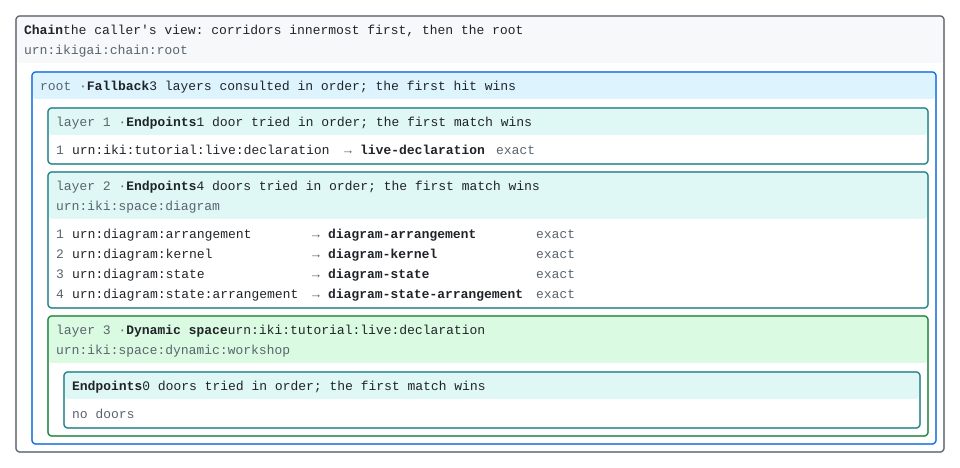
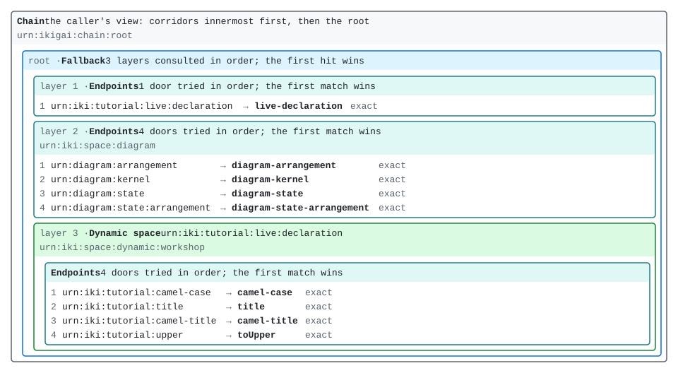

# A space that changes while it runs

[Tic-tac-toe, VII](tic-tac-toe-7.md) moved the game's arrangement into a file. The endpoints
stayed in Rust, in a `Registry`, and core's `build` read the file once, when the kernel was
made, and handed back a space. It also drew that space with `ikigai_diagram::render`. What it
could not do is change the space afterwards: to give the game a door it did not have, you
edited the file and built a new kernel.

This chapter keeps the same two halves, a registry of endpoints and a declaration that only
arranges them, and lets the declaration change while the kernel runs. The tool is
`ikigai-core`'s `DynamicSpace` (0.1.109, ledger #2006): a space inside the host's root that
rebuilds itself from a **declaration resource** whenever that resource is written. The root
never changes. Only the doors inside the dynamic space do.

It leans on one rule from [Golden threads in practice](../getting-started/golden-threads.md):
a cut takes what hung from it. Every answer a dynamic space serves hangs from one thread that
the space owns, and every change to the space cuts that thread. That is why a removed door
takes its cached answers with it.

Nothing here needs a server or a REPL. If a `ttt-host` or an `ikigai serve` from an earlier
chapter is still running, it can stay running: this chapter uses neither. Every listing below
runs on every build of the book, against the crate `crates/live-space`. The page's own kernel
has no dynamic space, so this chapter has no Run buttons.

## The host

<!-- urn-gate: illustration urn:iki:space:dynamic:workshop — the dynamic space's name, and its
     thread's. A space and a thread, not a resource: only its `:status` door answers. -->
<!-- urn-gate: illustration urn:iki:space:diagram — the name ikigai-diagram's space claims, as
     the picture prints it. Not a resource. -->

The registry holds four endpoints the book already wrote: Part I's `camel-case`, `title` and
`camel-title` (from [Hello, resource](../getting-started/hello-resource.md)), and ikigai-fn's
`toUpper`. Each is registered under the name it gives itself, and none of them is bound to
any name yet:

```rust,ignore
{{#include ../../../../crates/live-space/src/lib.rs:registry}}
```

They are three kinds of endpoint: a pure function of its argument (`camel-case`, `toUpper`),
an endpoint over state the host holds (`title`), and a composite that reads another resource
through the kernel (`camel-title` reads `title`). The registry does not care which is which.
A declaration binds a door to an endpoint by its name, and never makes one.

The declaration lives at a name of its own:

```rust,ignore
{{#include ../../../../crates/live-space/src/lib.rs:names}}
```

`Sink` writes an arrangement there, in the s-expression form Tic-tac-toe VII's file is
written in; `Source` answers it as the `ik:` Turtle core builds from. The host's root is
three layers: the declaration, then `ikigai-diagram`'s space (`urn:diagram:kernel`, the
picture Tic-tac-toe VII drew from a file, here drawn from the running kernel), then the
dynamic space:

```rust,ignore
{{#include ../../../../crates/live-space/src/lib.rs:kernel}}
```

The order matters: no door the declaration binds can shadow the declaration, or the picture.

Starting the host is three steps: make the space, put it in the kernel, and start the loop
that rebuilds it:

```rust,ignore
{{#include ../../../../crates/live-space/src/lib.rs:start}}
```

`DynamicSpace::new` is where the space gets its name. `"workshop"` becomes
`urn:iki:space:dynamic:workshop`, which is the space's name, the name of the thread every
answer it serves hangs from, and the prefix of its status door.

`drive` is the host's loop. It listens for cuts of the declaration's thread, reads the
declaration, binds it if it is good, and waits again. A space's `resolve` is synchronous and
cannot read a resource, so the rebuild happens here, outside resolution, when the
declaration changes. Core has no runtime, so the host runs the loop on one. Here that is a
`LocalPool`, and `Host::write` lets it catch up after each write, so each listing reads in
order:

```rust,ignore
{{#include ../../../../crates/live-space/src/lib.rs:write}}
```

The write is an ordinary `Sink`. The kernel cuts the declaration's thread after it, as it
does after every write, and the loop hears that cut. Nothing else tells the space to change.

## An empty space, with a name

Start the host, and ask the space what it holds. Its status door is
`urn:iki:space:dynamic:workshop:status`:

```rust
# extern crate live_space;
# extern crate ikigai_core;
use ikigai_core::Error;
use live_space::{source, Host};

let host = Host::start("workshop");

let status = host.read(source("urn:iki:space:dynamic:workshop:status", &[])).unwrap();
assert_eq!(
    status,
    "\
space: urn:iki:space:dynamic:workshop
declaration: urn:iki:tutorial:live:declaration
in force: nothing (the space is empty)
installs: 0
refused: the declaration could not be read: not found: urn:iki:tutorial:live:declaration
"
);

// Empty means empty: a name the registry could serve answers nothing yet.
let camel = source("urn:iki:tutorial:camel-case", &[("in", "resource oriented computing")]);
assert!(matches!(host.read(camel), Err(Error::Unresolved(_))));
```

The status says what is in force (nothing), how many declarations have bound (none), and
why: the loop's first read found no declaration. A space that cannot read its declaration
binds nothing, rather than guessing. Until a declaration binds, every name in it answers
`Unresolved`.

Here is the host as `urn:diagram:kernel` draws it now:

<figure style="margin: 1em 0">
<a href="live-space-empty.svg"></a>
<figcaption>The host before anything is declared: <code>urn:diagram:kernel</code>, as the
host in <code>crates/live-space</code> answers it. Select the picture to open it at full
size.</figcaption>
</figure>

The third layer is the dynamic space: its name, the declaration it is built from, and inside
it, an endpoint space with no doors. The status door is not drawn. The space answers it
itself, ahead of anything a declaration binds, so no declaration can shadow it.

## Doors, added by a write

Now write a declaration that binds all four endpoints. Three doors use the names Part I
used. `toUpper` gets one in the tutorial's namespace, `urn:iki:tutorial:upper`, because the
declaration chooses the names and the endpoint does not:

```rust
# extern crate live_space;
use live_space::{source, Host};

let mut host = Host::start("workshop");
let picture = || source("urn:diagram:kernel", &[]);
let before = host.read(picture()).unwrap();
assert!(before.contains("3 doors across 3 endpoint spaces"));

host.write(
    r#"(endpoints
  (door "urn:iki:tutorial:camel-case" camel-case)
  (door "urn:iki:tutorial:title" title)
  (door "urn:iki:tutorial:camel-title" camel-title)
  (door "urn:iki:tutorial:upper" toUpper))"#,
);

let words = [("in", "resource oriented computing")];
assert_eq!(
    host.read(source("urn:iki:tutorial:camel-case", &words)).unwrap(),
    "resourceOrientedComputing"
);
assert_eq!(
    host.read(source("urn:iki:tutorial:upper", &words)).unwrap(),
    "RESOURCE ORIENTED COMPUTING"
);
assert_eq!(
    host.read(source("urn:iki:tutorial:camel-title", &[])).unwrap(),
    "resourceOrientedComputing"
);

let status = host.read(source("urn:iki:space:dynamic:workshop:status", &[])).unwrap();
assert!(status.contains("\ninstalls: 1\n"));
assert!(status.ends_with("refused: nothing since the last bind\n"));

// The picture was cut by the bind, and redraws with the four new doors.
assert!(!host.is_cached(&picture()));
let after = host.read(picture()).unwrap();
assert!(after.contains("7 doors across 3 endpoint spaces"));
assert!(after.contains("door 4: urn:iki:tutorial:upper (exact) is answered by toUpper"));
```

All four answer, and `camel-title` still reads `title` through the kernel, as it did in
Part I. Its sub-request resolves from the root, finds `title` in the dynamic space, and
composes as before. The status counts one install. Its `in force` line is now the digest of
the declaration that bound.

The picture changed without anyone asking for it to change. `urn:diagram:kernel` is a
pure function of `urn:kernel:topology`, so it is cached, and the topology hangs from the
kernel's bindings thread, `urn:kernel:bindings`. A successful bind cuts that thread. That cut
is the only thing that makes the picture stale: nothing polls, and nothing redraws a picture
nobody asks for. The next read draws this:

<figure style="margin: 1em 0">
<a href="live-space-doors.svg"></a>
<figcaption>The host after one write to its declaration. A test in
<code>crates/live-space</code> holds both pictures to what the host draws.</figcaption>
</figure>

A page that shows this picture and listens for that thread (see
[A spreadsheet, VII](spreadsheet-7.md), later in the book) would redraw it the moment a
change binds. That is push, and the bindings thread is what it would listen to.

## A door removed, and what it served

Before you change a space, you can ask what the change will cost. Every answer the space has
served hangs from its thread, so `urn:kernel:dependents` lists them, as it did for `title`'s
thread in [Golden threads in practice](../getting-started/golden-threads.md). Read the four
names once, ask, and then write a declaration without `camel-title`:

```rust
# extern crate live_space;
# extern crate ikigai_core;
use std::sync::atomic::Ordering;
use ikigai_core::Error;
use live_space::{source, Host};

let mut host = Host::start("workshop");
host.write(
    r#"(endpoints
  (door "urn:iki:tutorial:camel-case" camel-case)
  (door "urn:iki:tutorial:title" title)
  (door "urn:iki:tutorial:camel-title" camel-title)
  (door "urn:iki:tutorial:upper" toUpper))"#,
);
let words = [("in", "resource oriented computing")];
let camel_title = || source("urn:iki:tutorial:camel-title", &[]);
let title = || source("urn:iki:tutorial:title", &[]);
host.read(source("urn:iki:tutorial:camel-case", &words)).unwrap();
host.read(source("urn:iki:tutorial:upper", &words)).unwrap();
host.read(camel_title()).unwrap();
assert_eq!(host.title.reads.load(Ordering::SeqCst), 1);

let dependents = |host: &Host| {
    host.read(source("urn:kernel:dependents", &[("thread", "urn:iki:space:dynamic:workshop")]))
        .unwrap()
};
assert_eq!(
    dependents(&host),
    "\
dependents of urn:iki:space:dynamic:workshop  (cut 1 time)
  4 live cached entries hang from it — a cut makes them stale, and the next read of each recomputes it
  urn:iki:tutorial:camel-case   text/plain                     25 B  2 threads   root
  urn:iki:tutorial:camel-title  text/plain                     25 B  3 threads   root
  urn:iki:tutorial:title        text/plain                     27 B  2 threads   root
  urn:iki:tutorial:upper        text/plain                     27 B  2 threads   root
"
);

host.write(
    r#"(endpoints
  (door "urn:iki:tutorial:camel-case" camel-case)
  (door "urn:iki:tutorial:title" title)
  (door "urn:iki:tutorial:upper" toUpper))"#,
);

// The door is gone, and so is what it served.
assert!(matches!(host.read(camel_title()), Err(Error::Unresolved(_))));
assert!(dependents(&host).contains("a cut would recompute nothing"));

// So is everything else the space served: `title` kept its door, and is read again.
assert!(!host.is_cached(&title()));
host.read(title()).unwrap();
assert_eq!(host.title.reads.load(Ordering::SeqCst), 2);
```

`camel-title` answers `Unresolved`, the same answer as a name that was never bound, and its
cached answer is gone. If the cache had kept it, a reader would be served an answer from a
door that no longer exists, and no read could tell them so.

The `(cut 1 time)` is the first bind. A space's thread is cut by every bind, including the
one that filled it.

The listing also shows what version one of the cut costs. `title` kept its door, but its
cached answer went too, and the next read ran the endpoint again. This is the **coarse
cut**: any change to a dynamic space cuts everything it served, because every answer hangs
from the same thread. Cutting only what the changed doors served (ledger #2034) is the finer
version, not built yet. The coarse one is never wrong, only sometimes wasteful: the cost of a
change is one recompute of each answer the space had served.

The cut is also what lets the space keep one name across versions. A space's name is a
promise to the cache: same name, same doors. A dynamic space breaks that on every change,
and keeps the name anyway, because nothing cached under the old doors survives the change.

## A change refused

A declaration may only arrange what the host registered. Here is one that keeps `toUpper` and
adds a Lisp function, `lisp-reverse`, which this host never registered:

<!-- urn-gate: illustration urn:iki:tutorial:reverse — the door of a declaration this
     chapter's host refuses; nothing is ever bound there. -->

```rust
# extern crate live_space;
# extern crate ikigai_core;
use ikigai_core::Error;
use live_space::{source, Host};

let mut host = Host::start("workshop");
host.write(
    r#"(endpoints
  (door "urn:iki:tutorial:camel-case" camel-case)
  (door "urn:iki:tutorial:upper" toUpper))"#,
);
let words = [("in", "resource oriented computing")];
let camel = || source("urn:iki:tutorial:camel-case", &words);
host.read(camel()).unwrap();

host.write(
    r#"(endpoints
  (door "urn:iki:tutorial:upper" toUpper)
  (door "urn:iki:tutorial:reverse" lisp-reverse))"#,
);

let status = host.read(source("urn:iki:space:dynamic:workshop:status", &[])).unwrap();
assert!(status.contains("\ninstalls: 1\n"));
assert!(status.contains(
    "\nrefused: <urn:ikigai:space:_:1:door:2> binds `lisp-reverse`, which the host did not \
     register: a declaration arranges registered endpoints and never mints one\n\
     refused at: urn:ikigai:space:_:1:door:2\n"
));

// The doors in force are the ones that bound last, and what they served is still cached.
assert!(host.is_cached(&camel()));
assert_eq!(host.read(camel()).unwrap(), "resourceOrientedComputing");
assert!(matches!(
    host.read(source("urn:iki:tutorial:reverse", &[("in", "a b")])),
    Err(Error::Unresolved(_))
));
```

<!-- urn-gate: illustration urn:ikigai:space:_:1:door:2 — the name core's refusal gives the
     second door of the declaration's first anonymous space. Not a resource. -->

The refusal is the one Tic-tac-toe VII's `undo` declaration met, word for word, because it is
the same check. Here it does not stop anything. The doors that bound last stay in force, a
refused change cuts nothing, and the status says what was refused, where, and the digest of
the text that was refused. The next good declaration clears it.

A dynamic space fails closed in both directions. It starts empty rather than guessing, and a
bad change keeps the last good doors rather than half-applying. Getting a Lisp function into
the space is the host's job, not the declaration's: a host that links `ikigai-lisp` and
registers its functions could bind them by name exactly as `toUpper` is bound here. This
book's crates do not link it.

There is no capability for changing a dynamic space. The authority to change it is the
authority to write its declaration, which whatever store holds the declaration already
grants or refuses. This host's declaration takes any write from root, and a real host would
put it behind a store that checks.

## A view: a name for a name the host already serves

An alias rule, from [Scope and alias](../getting-started/scope-and-alias.md), renames one name
to another inside one space: the rewritten name is looked for in the alias's own child. Inside
a dynamic space that is a trap. A rule that pointed at `urn:diagram:kernel` would look for it
inside the dynamic space and miss, because the host serves it in a different layer.

`ikigai-core` 0.1.110 adds the other kind of rule: one that resolves **at the root**. A name it
matches is asked again from the root of the caller's chain, under the caller's own capability.
That is a **view**. This declaration is one view and nothing else. A declaration is the whole
space, so a host that wrote it over the four doors would lose them; the listing below starts
from an empty space:

```turtle
{{#include ../../../../crates/live-space/view.ttl}}
```

It is Turtle, not an s-expression: the s-expression form (`ikigai-sexpr` 0.2.3) cannot write
`resolveAt` yet. Printing this declaration as an s-expression drops it, and turns the view
into an ordinary rule, so this chapter writes the Turtle core reads, which says it. The
listing checks that the printer still drops it, so a release that fixes this will fail the
build here until the chapter is updated:

<!-- urn-gate: illustration urn:iki:tutorial:live:picture — the view the declaration in
     crates/live-space/view.ttl binds, in this chapter's host only. -->

```rust
# extern crate live_space;
# extern crate ikigai_core;
# extern crate ikigai_sexpr;
use ikigai_core::{Capability, Error, Topology};
use live_space::{source, Host, VIEW};

let mut host = Host::start("workshop");
host.write(VIEW);
let status = host.read(source("urn:iki:space:dynamic:workshop:status", &[])).unwrap();
assert!(status.ends_with("refused: nothing since the last bind\n"));

// The view answers what the name it points at answers.
let view = || source("urn:iki:tutorial:live:picture", &[]);
let picture = host.read(view()).unwrap();
assert_eq!(picture, host.read(source("urn:diagram:kernel", &[])).unwrap());
assert!(picture.contains("1 rule tried in order"));

// It grants nothing. `urn:diagram:kernel` needs `urn:cap:kernel:inspect`; a caller without
// it is refused through the view in the same words as when asking directly.
let listener = Capability::scoped(["urn:cap:kernel:listen"]);
let direct = host.read_as(source("urn:diagram:kernel", &[]), &listener);
let through = host.read_as(view(), &listener);
assert!(matches!(direct, Err(Error::Denied(_))));
assert_eq!(direct.unwrap_err().to_string(), through.unwrap_err().to_string());

// The s-expression printer cannot write `resolveAt` yet (ikigai-sexpr 0.2.3).
let printed =
    ikigai_sexpr::topology_to_arrangement(&Topology::from_turtle(VIEW).unwrap()).unwrap();
assert!(!printed.contains("root"));
```

A view can only read what the caller could already read. Its forwarding endpoint declares no
capability, and its sub-request carries the caller's. It also never stands in for a name an
earlier layer answers, because the dynamic space is consulted only after the layers ahead of
it. The view's answer is a cache entry of its own that depends on the target's: cutting
`urn:kernel:bindings` redraws both. Inside a dynamic space it also hangs from the space's
thread, so the next change to the declaration cuts it, like everything else the space served.

The view's own answer, the picture, now shows the alias as the dynamic space's only content.
That is the `1 rule` the listing checks for.

## What it does not do yet

- **The cut is coarse.** Any successful change cuts everything the space served, including
  the answers of doors that did not change (ledger #2034).
- **One loop per space.** Two loops rebuilding the same space are not serialized, and the
  last to bind wins. A host runs one.
- **No sealing levels.** A level that seals names is refused in a dynamic space, because a
  running kernel's seals are fixed when it is built.
- **Views are Turtle only** until `ikigai-sexpr` can print and read `resolveAt`.
- **Not in the page.** The page's kernel has no dynamic space, so there are no Run buttons
  here; the listings run in `mdbook test` instead.

The same mechanism, one thread per space, also gives a server a cheap way to forget a
session. [A spreadsheet, VII](spreadsheet-7.md#what-a-server-needs), later in the book,
shows it.

## What was built

| what | where | what it is |
|---|---|---|
| the endpoints | `live_space::registry` | code: four endpoints Part I and ikigai-fn already had, registered by name and bound nowhere |
| the declaration | `urn:iki:tutorial:live:declaration` | data: an arrangement, written by a `Sink`, read as Turtle |
| the space | `urn:iki:space:dynamic:workshop` | core's `DynamicSpace`: empty until a declaration binds, rebuilt on every write, one thread for everything it served |
| its status | `urn:iki:space:dynamic:workshop:status` | live state: what is in force, how many binds, the last refusal and where |
| the loop | `DynamicSpace::drive` | a future the host runs: hear the declaration's cut, read, check, bind |
| the picture | `urn:diagram:kernel` | ikigai-diagram 0.2.1: the host's arrangement, cached and redrawn when a bind cuts `urn:kernel:bindings` |
| a view | `view.ttl` | data: an alias rule that resolves at the root, and grants nothing |

Tic-tac-toe VII moved where the endpoints are bound out of the code. This chapter makes that
data live: the host's arrangement now changes the way any other resource does, by a write,
and the cache, the status and the picture all follow from one cut.
